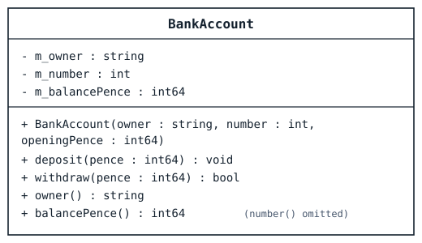

Object-oriented design rests on four principles: abstraction, encapsulation, decomposition and generalization. This post covers the first two, with C++ examples and the UML notation for drawing them. [Part 2](/blog/object-oriented-modelling-decomposition-generalization/) covers the other two.

The principles matter more now than when I first wrote this. With AI tools writing more of the code, the part that's still yours is deciding what the pieces are and where their edges go. The [C++ Roadmap 2027](/roadmap/#agents) makes the same argument.

## Why model before you code

Between understanding what a product must do and writing the code sits design. A good design describes the problem in terms that both the people who use the software and the people who build it can follow. Object-oriented design does that by describing both sides as objects: an account, an order, a sensor.

It usually happens in two passes that repeat. Conceptual design (often called object-oriented analysis) finds the main objects and breaks the problem into manageable pieces. Technical design then fills in each object's attributes and behaviour until a developer can implement it. Both produce models, and the usual notation for those models is the [Unified Modeling Language (UML)](https://www.uml.org/). A class diagram is to software roughly what a scale model is to a building: it shows what each part is and how the parts relate, without the detail.

## How languages got here

Each generation of languages fixed a problem the previous one left open. Knowing the order helps when you meet old code, and explains why classes look the way they do.

| Languages | Period | What they added | What was still a problem |
| --- | --- | --- | --- |
| Fortran, COBOL | Late 1950s to 1960s | Subroutines to split up large programs, with shared global data | Any routine could change global data and break another routine |
| Algol 68, Pascal | Late 1960s to early 1970s | Scopes and local variables, and abstract data types | Large programs still lived in one file |
| C, Modula-2 | 1970s | Code spread across files, with headers as interfaces | No way to build one abstract data type on top of another |
| Object-oriented languages (C++, Java, Python) | 1980s onward | Classes, inheritance, and control over what's visible | Complexity moved into the design, which is why these principles exist |

## Abstraction: keep only what matters here

Abstraction means reducing a concept to the attributes and behaviour that matter for your purpose, and leaving everything else out. The key words are "for your purpose". A person in a fitness app has a resting heart rate and weekly distance; the same person in a game has a username and a high score. Neither abstraction is wrong. Each is right for its context, and the first question when designing a class is which context you're in.

An abstraction has two halves. Its attributes are the facts it holds, like a tiger's age, whose value changes while the attribute stays. Its behaviours are what it's responsible for doing, like hunting and sleeping. Include only the essential ones. A lion in a hunting simulation doesn't need a preferred sleeping position; if the context changes, the abstraction should change with it.

A good abstraction also follows the principle of least astonishment: nothing in it should surprise someone who knows the concept. A `BankAccount` with a `deposit` method is unsurprising. One with a `sendBirthdayCard` method is a sign two concepts have been mixed.

In code, a class is how you write an abstraction down. Every object made from it has those essential parts, with its own values, the way every gingerbread man from the same cutter has a head and arms but its own icing.

## Encapsulation: protect the rules

Encapsulation bundles an object's data with the functions that work on it, and decides which parts the rest of the program may touch. The point isn't secrecy for its own sake. It's that an object can then guarantee its own rules, its invariants, because nothing outside can break them.

Here's a bank account whose rule is that the balance can never go negative:

```cpp
class BankAccount {
public:
    BankAccount(std::string owner, int number, std::int64_t openingPence)
        : m_owner(std::move(owner)), m_number(number), m_balancePence(openingPence) {
        if (openingPence < 0) throw std::invalid_argument("opening balance cannot be negative");
    }

    void deposit(std::int64_t pence) {
        if (pence <= 0) throw std::invalid_argument("deposit must be positive");
        m_balancePence += pence;
    }

    bool withdraw(std::int64_t pence) {
        if (pence <= 0 || pence > m_balancePence) return false;
        m_balancePence -= pence;
        return true;
    }

    const std::string& owner() const { return m_owner; }
    int number() const { return m_number; }
    std::int64_t balancePence() const { return m_balancePence; }

private:
    std::string m_owner;
    int m_number;
    std::int64_t m_balancePence;
};
```

```cpp
BankAccount account("Sara Ahmadi", 12345, 100'000);   // £1,000.00
account.deposit(50'000);
account.withdraw(200'000);   // false: would go negative
account.withdraw(50'000);    // true
// account.m_balancePence = -1;   // does not compile: the member is private
```

The balance is private, and the only ways to change it are `deposit` and `withdraw`, which both check the rule. There's a getter for the balance but no setter, because "set the balance to any number" isn't an operation a bank account has. Money is stored as whole pence in a 64-bit integer, since a `double` can't represent amounts like 0.10 exactly.

Compare that with the class people often write when they hear "encapsulation":

```cpp
class Person {
public:
    void setAge(int age) { m_age = age; }
    int getAge() const { return m_age; }
private:
    int m_age{};
};
```

This hides the member but protects nothing: any caller can still set any age, including -40. A getter and setter for every field is a public variable with extra steps. Encapsulation starts to pay off when the interface is made of operations that mean something, like `withdraw` and `haveBirthday`, and the class checks its rules inside them.

Two more benefits follow. Because callers only see the interface, the implementation can change without breaking them; the account could store its balance in a database tomorrow and `main` wouldn't notice. And each class can be understood as a black box: you need to know what goes in and what comes out, not how it works inside. That boundary is what makes large programs manageable.

## Drawing it in UML

A UML class diagram shows each class as a box with three sections: the name, the attributes and the operations.



Attributes are written as `name : type` and operations as `name(parameters) : return type`. A symbol in front shows who can see the member:

| Symbol | Access |
| --- | --- |
| `-` | private |
| `#` | protected |
| `+` | public |

So `- m_balancePence : int64` is a private attribute, and `+ withdraw(pence : int64) : bool` is a public operation returning a `bool`. Reading the diagram, you can see the encapsulation at a glance: every attribute has a minus sign, and the only way in is through the plus-sign operations.

You don't need a drawing tool for this. [PlantUML](https://plantuml.com/class-diagram) turns plain text into diagrams, which means they can live in the repository next to the code and change in the same commit:

```text
@startuml
class BankAccount {
  - m_owner : string
  - m_number : int
  - m_balancePence : int64
  + deposit(pence : int64) : void
  + withdraw(pence : int64) : bool
  + balancePence() : int64
}
@enduml
```

Editors such as VS Code have PlantUML extensions that preview the diagram as you type.

## Summary

Abstraction decides what a class is, by keeping only what matters in its context. Encapsulation decides what a class guarantees, by making its rules impossible to break from outside. Part 2 looks at how classes relate to each other: [decomposition and generalization](/blog/object-oriented-modelling-decomposition-generalization/).

The C++ examples compile with `clang++ -std=c++20 -Wall -Wextra` once `<cstdint>`, `<stdexcept>`, `<string>` and `<utility>` are included.
