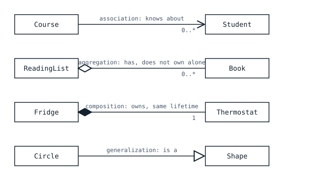

[Part 1](/blog/object-oriented-modelling-abstraction-encapsulation/) covered abstraction, which decides what a class is, and encapsulation, which decides what it guarantees. This part is about how classes relate to each other. Decomposition splits a system into parts, and generalization pulls shared behaviour up into a common parent.

In C++ these relationships are more than diagrams. Each one corresponds to a decision about ownership: who creates an object, who destroys it, and who is merely pointing at it. Get that decision wrong and you get the classic C++ bugs, so the examples below make it explicit.

## Decomposition: wholes and parts

Decomposition breaks a complex thing into smaller parts, each with one clear responsibility, so you can understand and change one part without holding the whole system in your head. It works in both directions. You can split a whole into parts, or assemble separate parts into a whole.

Parts can be wholes themselves: a kitchen is part of a house and is also made of an oven and a fridge. The number of parts can be fixed, like an oven's four burners, or change over time, like the food in the fridge.

The important question about each part is its lifetime relative to the whole. A fridge's thermostat is built into it and goes when the fridge goes. A carton of milk in the fridge has its own life; it can go off without the fridge breaking, and the fridge can be thrown out after the milk is moved. A part can also be shared between wholes at the same time, or deliberately kept exclusive.

UML names three strengths of relationship along this scale: association, aggregation and composition.



### Association: one object knows about another

An association is the loosest link. Two classes work together, but neither owns the other, and either can exist without the other. A course has students enrolled, and a student can be enrolled in several courses, but closing a course doesn't delete anyone.

```cpp
class Student {
public:
    Student(int id, std::string name) : m_id(id), m_name(std::move(name)) {}
    int id() const { return m_id; }
    const std::string& name() const { return m_name; }
private:
    int m_id;
    std::string m_name;
};

class Course {
public:
    explicit Course(std::string title) : m_title(std::move(title)) {}
    void enrol(const Student& s) { m_students.push_back(&s); }
    const std::vector<const Student*>& students() const { return m_students; }
private:
    std::string m_title;
    std::vector<const Student*> m_students;  // does not own them
};

Student alice{1, "Alice"}, bob{2, "Bob"};
Course intro{"Intro to Computer Science"}, algo{"Algorithms"};
intro.enrol(alice);
intro.enrol(bob);
algo.enrol(alice);   // the same Alice, in two courses
```

`Course` holds plain, non-owning pointers. In modern C++ a raw pointer is the conventional way to say "I refer to this but I'm not responsible for deleting it". The students are owned by whatever created them, and that owner must keep them alive at least as long as the courses that point at them. If the lifetimes can't be guaranteed, store `std::weak_ptr`, as in the [Observer pattern post](/blog/observer-pattern-cpp/), or store the student's ID and look it up.

In UML, an association is a line between the classes, with an arrow when only one side knows about the other and a multiplicity like `0..*` for "zero or more".

### Aggregation: a whole that has parts it doesn't own alone

Aggregation is a "has-a" relationship where the parts can exist without the whole, and can belong to several wholes at once. A reading list has books, but the book doesn't stop existing when you delete the list, and the same book can be on your list and mine.

```cpp
struct Book {
    std::string title;
    std::string author;
};

class ReadingList {
public:
    void add(std::shared_ptr<const Book> b) { m_books.push_back(std::move(b)); }
    const std::vector<std::shared_ptr<const Book>>& books() const { return m_books; }
private:
    std::vector<std::shared_ptr<const Book>> m_books;
};

auto sicp = std::make_shared<const Book>(Book{"Structure and Interpretation of Computer Programs", "Abelson and Sussman"});
ReadingList mine, yours;
mine.add(sicp);
yours.add(sicp);   // one Book, two lists
```

Shared ownership fits here: the book lives as long as any list (or anyone else) still holds it. Storing the books by value in a `std::vector<Book>` would give each list its own private copies instead. That's composition, not aggregation, and it's the most common way the two get mixed up in code.

UML draws aggregation with a hollow diamond on the whole's end. In practice the line between association and aggregation is blurry, and many designers only distinguish "owns" from "doesn't own". The useful question is always the same: who decides when the part dies?

### Composition: parts that live and die with the whole

Composition is the strongest relationship. The whole owns its parts outright, creates them, and destroys them; the parts have no meaning on their own. A fridge and its thermostat:

```cpp
class Thermostat {
public:
    void set(double celsius) { m_target = celsius; }
    double target() const { return m_target; }
private:
    double m_target = 4.0;
};

class Fridge {
public:
    void setTemperature(double celsius) { m_thermostat.set(celsius); }
    double temperature() const { return m_thermostat.target(); }
private:
    Thermostat m_thermostat;  // created and destroyed with the fridge
};
```

The simplest way to express composition in C++ is a member held by value: it's constructed with the `Fridge` and destroyed with it, automatically. Use `std::unique_ptr` instead when the part is polymorphic, optional, or too large to embed, as in the [Strategy pattern post](/blog/strategy-pattern-cpp/). Either way there's exactly one owner. Notice too that nothing outside can reach the thermostat directly; the fridge decides what to expose, which is encapsulation doing its job.

UML draws composition with a filled diamond on the whole's end.

| Relationship | Lifetime | Typical C++ |
| --- | --- | --- |
| Association | Independent | Raw pointer or reference (non-owning), `weak_ptr`, or an ID |
| Aggregation | Part can outlive the whole, may be shared | `shared_ptr`, or non-owning pointers to parts owned elsewhere |
| Composition | Part lives and dies with the whole | Member by value, or `unique_ptr` |

## Generalization: shared behaviour in one place

Generalization removes repetition by moving what several classes have in common into one more general class. A function does the same thing for behaviour: write the algorithm once and call it with different data. In object-oriented design, inheritance does it for whole types. The parent (superclass) holds the shared interface and behaviour, and each child (subclass) adds or specializes what's different.

Shapes are the standard example. Every shape has an area and a perimeter, computed differently:

```cpp
class Shape {
public:
    virtual ~Shape() = default;
    virtual double area() const = 0;
    virtual double perimeter() const = 0;
};

class Circle : public Shape {
public:
    explicit Circle(double r) : m_r(r) {}
    double area() const override { return std::numbers::pi * m_r * m_r; }
    double perimeter() const override { return 2 * std::numbers::pi * m_r; }
private:
    double m_r;
};

class Square : public Shape {
public:
    explicit Square(double side) : m_side(side) {}
    double area() const override { return m_side * m_side; }
    double perimeter() const override { return 4 * m_side; }
private:
    double m_side;
};

class Triangle : public Shape {
public:
    Triangle(double a, double b, double c) : m_a(a), m_b(b), m_c(c) {
        if (a + b <= c || a + c <= b || b + c <= a) throw std::invalid_argument("not a triangle");
    }
    double perimeter() const override { return m_a + m_b + m_c; }
    double area() const override {  // Heron's formula
        const double s = perimeter() / 2;
        return std::sqrt(s * (s - m_a) * (s - m_b) * (s - m_c));
    }
private:
    double m_a, m_b, m_c;
};
```

```cpp
std::vector<std::unique_ptr<Shape>> shapes;
shapes.push_back(std::make_unique<Circle>(5));
shapes.push_back(std::make_unique<Square>(4));
shapes.push_back(std::make_unique<Triangle>(3, 4, 5));
for (const auto& s : shapes)
    std::cout << "area " << s->area() << ", perimeter " << s->perimeter() << '\n';
```

The loop shows what this buys you: code written against `Shape` works with every current and future shape. A few details are easy to miss. The virtual destructor is required, because these objects are deleted through a `Shape` pointer. `override` makes the compiler check that each function really overrides something. `std::numbers::pi` (C++20) replaces hand-typed constants like `3.14159`. And the triangle is defined by its three sides, so both its area and perimeter are correct for any valid triangle.

UML draws generalization as a line with a hollow triangle pointing at the parent.

Name superclasses and subclasses after the concepts they represent, and keep the hierarchy shallow. Inheritance is the tightest coupling C++ has: a change to `Shape` reaches every subclass. It's the right tool when the subclasses really are kinds of the parent ("a circle is a shape") and you want to treat them uniformly. When you only want to reuse some code, composition is usually the better choice.

## Summary

Decomposition splits a system into parts, and the three relationships say how tightly each part is bound to its whole: association knows about it, aggregation has it without owning it alone, composition owns it outright. Generalization collects what several classes share into one parent so code can treat them uniformly. In C++, each of these is ultimately a choice of who owns what, written down in the types.

The examples above compile with `clang++ -std=c++20 -Wall -Wextra` once `<cmath>`, `<iostream>`, `<memory>`, `<numbers>`, `<stdexcept>`, `<string>`, `<utility>` and `<vector>` are included, and run cleanly under AddressSanitizer and UBSan.
