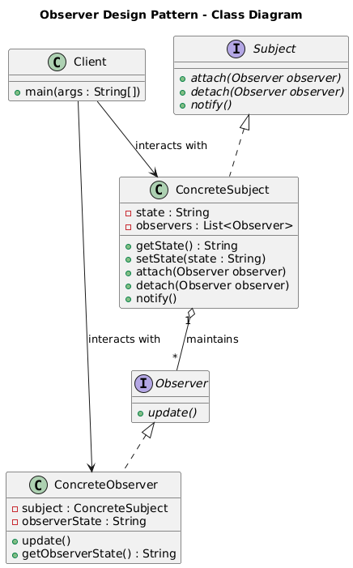

The Observer pattern sets up a one-to-many relationship: one object, the subject, keeps a list of other objects, the observers, and tells all of them when its state changes. The subject only knows that its observers have an `update` function. It doesn't know what they are or what they do with the news, so you can add a new observer without touching the subject.

It's another of the patterns in *Design Patterns* (Gamma, Helm, Johnson and Vlissides, 1994), and you've used it even if you've never named it: GUI event handlers, signals and slots in Qt, and "listeners" in most frameworks are all observers.



## How it works

Observers register with the subject. When the subject's state changes, it walks its list and calls `update` on each one. Each observer decides what to do with the new state, and observers can join or leave while the program runs.

The subject can send the new data along with the call (the push model), or just say "something changed" and let each observer ask for what it needs (the pull model). Push is simpler; pull is better when observers want very different slices of a large state.

In C++, the interesting part of this pattern is lifetime. The subject holds references to objects it doesn't own, which is exactly the situation where dangling pointers and leaks come from. Most short examples get this wrong, so the example below is built around it.

## Example: a weather station

This is the weather station from *Head First Design Patterns*: a `WeatherData` object receives new measurements and three displays react to them.

### The data and the observer interface

```cpp
namespace ws {

struct Measurements {
    double temperature{};
    double humidity{};
    double pressure{};
};

class Observer {
public:
    virtual ~Observer() = default;
    virtual void update(const Measurements& m) = 0;
};

}  // namespace ws
```

Passing one `Measurements` struct (push model) instead of three loose `double`s means adding a new measurement later won't change every observer's signature.

### The subject

```cpp
namespace ws {

class WeatherData {
public:
    void subscribe(const std::shared_ptr<Observer>& observer) { m_observers.push_back(observer); }

    void unsubscribe(const std::shared_ptr<Observer>& observer) {
        std::erase_if(m_observers, [&](const std::weak_ptr<Observer>& w) {
            auto o = w.lock();
            return !o || o == observer;
        });
    }

    void setMeasurements(const Measurements& m) {
        m_current = m;
        notify();
    }

private:
    void notify() {
        // Work on a copy: an observer may unsubscribe while we are notifying.
        const auto observers = m_observers;
        for (const auto& w : observers) {
            if (auto o = w.lock()) o->update(m_current);
        }
        std::erase_if(m_observers, [](const auto& w) { return w.expired(); });
    }

    std::vector<std::weak_ptr<Observer>> m_observers;
    Measurements m_current;
};

}  // namespace ws
```

Three decisions here prevent the usual bugs.

The subject stores `std::weak_ptr`, not `std::shared_ptr`. A weather station shouldn't decide how long a display lives. If it held `shared_ptr`s, a display the rest of the program had finished with would stay alive and keep printing, just because the subject still pointed at it. With `weak_ptr`, `lock()` returns an empty pointer once the display is gone, and the subject skips it.

`notify` iterates over a copy of the list. If an observer calls `unsubscribe` from inside its own `update`, it changes `m_observers` while we're looping over it, which invalidates the iterator. Looping over a copy avoids that.

Dead entries are pruned after each notification with C++20's `std::erase_if`, so the list doesn't grow forever.

### Three observers

```cpp
namespace ws {

class CurrentConditionsDisplay : public Observer {
public:
    void update(const Measurements& m) override {
        std::cout << "Current conditions: " << m.temperature << "F and " << m.humidity << "% humidity\n";
    }
};

class StatisticsDisplay : public Observer {
public:
    void update(const Measurements& m) override {
        ++m_readings;
        m_sum += m.temperature;
        m_max = std::max(m_max, m.temperature);
        m_min = std::min(m_min, m.temperature);
        std::cout << "Avg/Max/Min temperature = " << m_sum / m_readings << "/" << m_max << "/" << m_min << "\n";
    }

private:
    int m_readings{};
    double m_sum{};
    double m_max = std::numeric_limits<double>::lowest();
    double m_min = std::numeric_limits<double>::max();
};

class ForecastDisplay : public Observer {
public:
    void update(const Measurements& m) override {
        m_last = m_current;
        m_current = m.pressure;
        std::cout << "Forecast: ";
        if (m_current > m_last) std::cout << "Improving weather on the way!\n";
        else if (m_current == m_last) std::cout << "Same weather ahead!\n";
        else std::cout << "Cooler, rainy weather ahead!\n";
    }

private:
    double m_current = 29.92;
    double m_last{};
};

}  // namespace ws
```

One detail in `StatisticsDisplay` catches a lot of people: the starting maximum is `numeric_limits<double>::lowest()`, not `min()`. For floating-point types, `min()` is the smallest positive value, about 2.2 × 10⁻³⁰⁸. Start from that and a run of below-zero temperatures would report a maximum just above zero.

### Using it

```cpp
int main() {
    ws::WeatherData weather;
    auto current = std::make_shared<ws::CurrentConditionsDisplay>();
    auto stats = std::make_shared<ws::StatisticsDisplay>();
    weather.subscribe(current);
    weather.subscribe(stats);
    {
        auto forecast = std::make_shared<ws::ForecastDisplay>();
        weather.subscribe(forecast);
        weather.setMeasurements({80, 65, 30.4});
        weather.setMeasurements({82, 70, 29.2});
    }  // forecast is destroyed here; WeatherData does not keep it alive
    weather.unsubscribe(current);
    weather.setMeasurements({-5, 90, 29.2});
}
```

The forecast display leaves the scope after two readings and simply stops receiving updates. The current-conditions display unsubscribes explicitly. The last reading reaches only the statistics display, which now reports `82/-5` as its maximum and minimum.

## Things to watch for

Notification order isn't something observers should depend on. Here it's the order they subscribed, but if one observer needs another to have run first, the two are more coupled than the pattern suggests.

Notifications are synchronous, so a slow observer slows down everything that changes the subject. If an update can take a while, have the observer queue the work instead of doing it inside `update`.

An observer that changes the subject from inside `update` triggers another round of notifications. That can be fine, but it's an easy way to build an infinite loop.

Put together in one file with `<algorithm>`, `<iostream>`, `<limits>`, `<memory>` and `<vector>` included, the code above compiles with `clang++ -std=c++20 -Wall -Wextra` and runs cleanly under AddressSanitizer and UBSan.

The [Strategy pattern](/blog/strategy-pattern-cpp/) post uses the same approach to ownership with `std::unique_ptr`, where the object does own its parts.
