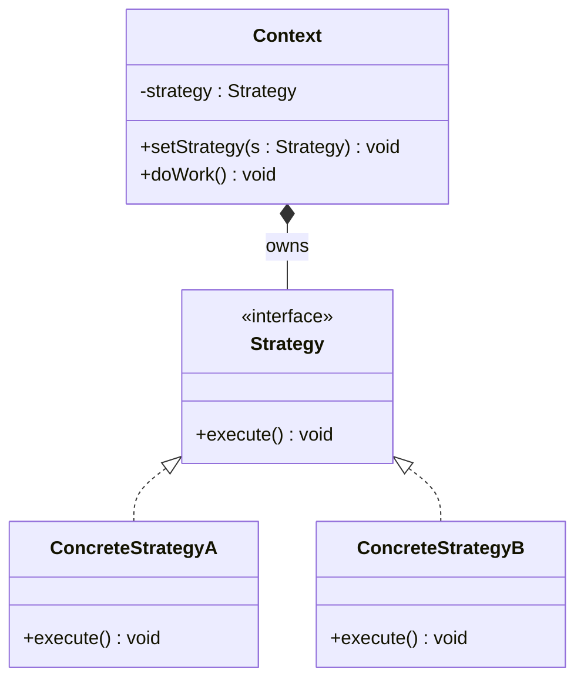
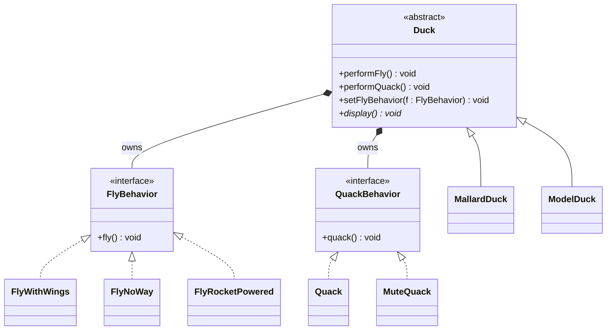

The Strategy pattern lets an object change how it does something without changing its own code. You pull the behaviour that varies into its own small class behind an interface, and the object holds whichever version it currently needs. Swapping the behaviour at runtime then means swapping one pointer.

It's one of the original 23 patterns in *Design Patterns* by Gamma, Helm, Johnson and Vlissides (1994), where it's described as defining a family of algorithms, encapsulating each one and making them interchangeable. The duck example below is the one *Head First Design Patterns* made famous, rewritten here in modern C++.

## The three parts



The context is the class your code talks to. It holds a strategy and forwards the work to it, and it can be given a different strategy later. The strategy interface declares the operation every variant must provide. The concrete strategies are the variants themselves, each one a small class.

Adding a new behaviour means adding a new concrete strategy. Neither the context nor the existing strategies change, which is the open-closed principle in practice.

## Example: ducks that fly and quack differently

A `Duck` can fly and quack, but not every duck does either the same way. A mallard flies with wings, a wooden model duck can't fly at all, and we might want to bolt a rocket onto the model later. Putting all of that into a `Duck` class hierarchy with overrides gets messy quickly, so flying and quacking become strategies.



The filled diamond means composition: each duck owns its two strategies, which is what the `std::unique_ptr` members below express.

### The strategy interfaces

```cpp
namespace duck {

class FlyBehavior {
public:
    virtual ~FlyBehavior() = default;
    virtual void fly() const = 0;
};

class QuackBehavior {
public:
    virtual ~QuackBehavior() = default;
    virtual void quack() const = 0;
};

}  // namespace duck
```

The virtual destructor matters: strategies are deleted through a base-class pointer, and without it that would be undefined behaviour.

### The concrete strategies

```cpp
namespace duck {

class FlyWithWings : public FlyBehavior {
public:
    void fly() const override { std::cout << "I'm flying with wings!\n"; }
};

class FlyNoWay : public FlyBehavior {
public:
    void fly() const override { std::cout << "I can't fly.\n"; }
};

class FlyRocketPowered : public FlyBehavior {
public:
    void fly() const override { std::cout << "I'm flying with a rocket!\n"; }
};

class Quack : public QuackBehavior {
public:
    void quack() const override { std::cout << "Quack!\n"; }
};

class MuteQuack : public QuackBehavior {
public:
    void quack() const override { std::cout << "...\n"; }
};

}  // namespace duck
```

### The context: Duck

```cpp
namespace duck {

class Duck {
public:
    virtual ~Duck() = default;

    void swim() const { std::cout << "I'm swimming.\n"; }
    virtual void display() const = 0;

    void performFly() const { m_fly->fly(); }
    void performQuack() const { m_quack->quack(); }

    void setFlyBehavior(std::unique_ptr<FlyBehavior> fly) { m_fly = std::move(fly); }
    void setQuackBehavior(std::unique_ptr<QuackBehavior> quack) { m_quack = std::move(quack); }

protected:
    Duck(std::unique_ptr<FlyBehavior> fly, std::unique_ptr<QuackBehavior> quack)
        : m_fly(std::move(fly)), m_quack(std::move(quack)) {}

private:
    std::unique_ptr<FlyBehavior> m_fly;
    std::unique_ptr<QuackBehavior> m_quack;
};

}  // namespace duck
```

Each duck owns its strategies, so `std::unique_ptr` is the right type: there's exactly one owner, and the strategy is deleted when the duck is. The setters take the pointer by value, which makes the transfer of ownership visible at the call site, where the caller has to write `std::move` or pass a temporary.

The class declares no copy or move operations, because `std::unique_ptr` already makes `Duck` movable and non-copyable. Writing those by hand would only add code that can go wrong. The constructor takes both strategies, so a duck can never exist without them, and there's no null pointer to check in `performFly`.

### Two kinds of duck

```cpp
namespace duck {

class MallardDuck : public Duck {
public:
    MallardDuck() : Duck(std::make_unique<FlyWithWings>(), std::make_unique<Quack>()) {}
    void display() const override { std::cout << "I'm a mallard duck.\n"; }
};

class ModelDuck : public Duck {
public:
    ModelDuck() : Duck(std::make_unique<FlyNoWay>(), std::make_unique<Quack>()) {}
    void display() const override { std::cout << "I'm a model duck.\n"; }
};

}  // namespace duck
```

### Swapping a strategy at runtime

```cpp
int main() {
    duck::MallardDuck mallard;
    mallard.display();
    mallard.performQuack();
    mallard.performFly();

    duck::ModelDuck model;
    model.display();
    model.performFly();                                              // I can't fly.
    model.setFlyBehavior(std::make_unique<duck::FlyRocketPowered>());
    model.performFly();                                              // I'm flying with a rocket!
}
```

The model duck starts out unable to fly. One call to `setFlyBehavior` later it flies with a rocket, and `ModelDuck` itself never changed.

## The lighter version: a callable

When a strategy is a single operation with no state of its own, a whole class hierarchy is often more than you need. `std::function` holds any callable with the right signature, so a lambda can be the strategy:

```cpp
class Robot {
public:
    explicit Robot(std::function<void()> move) : m_move(std::move(move)) {}
    void setMove(std::function<void()> move) { m_move = std::move(move); }
    void move() const { m_move(); }

private:
    std::function<void()> m_move;
};

Robot robot{[] { std::cout << "Rolling.\n"; }};
robot.move();
robot.setMove([] { std::cout << "Walking.\n"; });
robot.move();
```

I'd use the interface version when a strategy has several related operations or its own state, or when you want each variant to have a name in the codebase. I'd use `std::function` for one-off behaviour like a comparison, a retry policy or a callback. If the strategy never changes at runtime, a template parameter avoids the indirect call entirely; that's how the standard library takes the comparator in `std::sort`.

## When it helps and when it doesn't

Strategy pays off when one part of a class's behaviour varies independently of the rest, especially when it has to change while the program runs. It's a poor fit when there's only ever one behaviour, since the interface becomes ceremony, or when the variants need deep access to the context's internals, which is a sign they belong in the context after all.

Put together in one file with `<functional>`, `<iostream>`, `<memory>` and `<utility>` included, the code above compiles with `clang++ -std=c++20 -Wall -Wextra` and runs cleanly under AddressSanitizer and UBSan.
